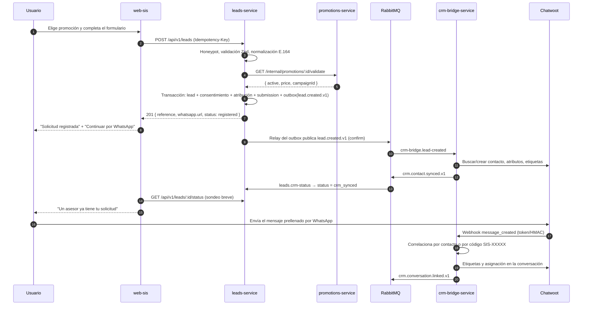

# Flujo del formulario y Chatwoot

## Estados que ve el usuario

| Estado | Origen | Texto |
| --- | --- | --- |
| Registrada | Respuesta 201/200 del backend | "Solicitud registrada" + código |
| Continuar por WhatsApp | Acción del usuario (enlace `wa.me` con mensaje prellenado) | botón principal |
| Sincronizando | `status` = `registered` o `crm_syncing` | "Enviando tu solicitud a un asesor…" |
| Sincronizada | `status` = `crm_synced` (evento real) | "Un asesor ya tiene tu solicitud." |
| Sin confirmación | `crm_failed` o tiempo de espera agotado | "Tu solicitud está guardada. Te contactaremos…" |

La pantalla «Conectando con un asesor — 75 %» del diseño original se sustituyó por estos estados porque una barra simulada no representa ningún hecho del sistema. Registrar un formulario no abre una conversación de WhatsApp: la conversación nace cuando el usuario envía el mensaje. Para que la empresa inicie el contacto sin mensaje previo se necesita una plantilla aprobada y consentimiento específico (segunda etapa).

## Códigos de error de `POST /api/v1/leads`

| HTTP | `code` | Cuándo |
| --- | --- | --- |
| 400 | `VALIDATION_ERROR` | Campos inválidos (`errors[]` por campo) |
| 400 | `IDEMPOTENCY_KEY_REQUIRED` | Falta la cabecera |
| 422 | `IDEMPOTENCY_KEY_REUSED` | Misma clave con un cuerpo distinto |
| 422 | `PROMOTION_NOT_AVAILABLE` | Promoción inexistente, inactiva o vencida |
| 429 | `RATE_LIMITED` | Demasiadas solicitudes por IP |
| 503 | `CATALOG_UNAVAILABLE` | promotions-service inalcanzable (con `Retry-After`) |
| 204 | — | Honeypot con contenido: no se persiste nada |
