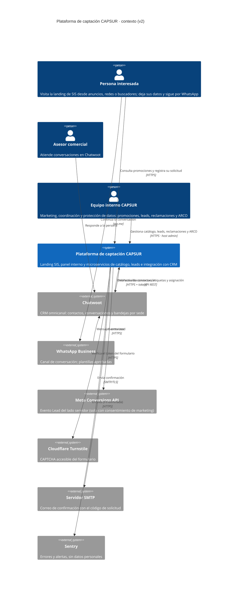
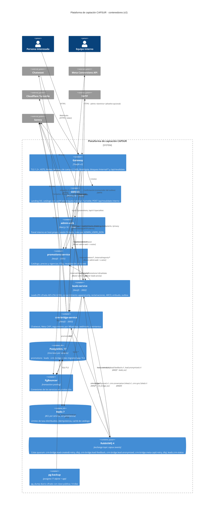

# Diagramas C4 (niveles 1 y 2)

Fuente de verdad de nombres, rutas y colas: `docs/architecture/v2-integration-spec.md`. Decisiones: ADR 0007–0011.

## Nivel 1 · Contexto del sistema



## Nivel 2 · Contenedores



## Topología de mensajería (detalle del nivel 2)

```mermaid
flowchart LR
  subgraph leads-service
    OB[(outbox)] --> PUB[publisher<br/>leads_svc]
  end
  PUB -- lead.created.v1<br/>lead.feedback.v1<br/>lead.anonymized.v1 --> EX{{capsur.events<br/>topic}}

  EX -- lead.created.v1 --> LC[crm-bridge.lead-created<br/>quorum]
  LC -. nack/DLX .-> RX{{capsur.events.retry}} --> LCR[crm-bridge.lead-created.retry<br/>TTL 30 s] -. DLX .-> EX
  LC -. agotado: publish .-> DLX{{capsur.events.dlx}} --> LCD[crm-bridge.lead-created.dlq]

  EX -- lead.created.v1 --> MC[crm-bridge.meta-capi<br/>quorum]
  MC -. DLX '' / .retry .-> MCR[crm-bridge.meta-capi.retry<br/>TTL 60 s] -. DLX '' / meta-capi .-> MC
  MC -. agotado: publish por amq.default .-> MCD[crm-bridge.meta-capi.dlq]

  EX -- lead.feedback.v1 --> LF[crm-bridge.lead-feedback<br/>sin reintento]
  EX -- lead.anonymized.v1 --> LA[crm-bridge.lead-anonymized<br/>x-delivery-limit 10]

  LC & MC & LF & LA --> CRM[crm-bridge-service<br/>crm_bridge_svc]
  CRM -- crm.# --> EX
  EX -- crm.# --> LS[leads.crm-status] --> CONS[leads-service]
```

Para exportar a SVG: `npx -y @mermaid-js/mermaid-cli -i docs/diagrams/c4.md -o c4.svg`.
