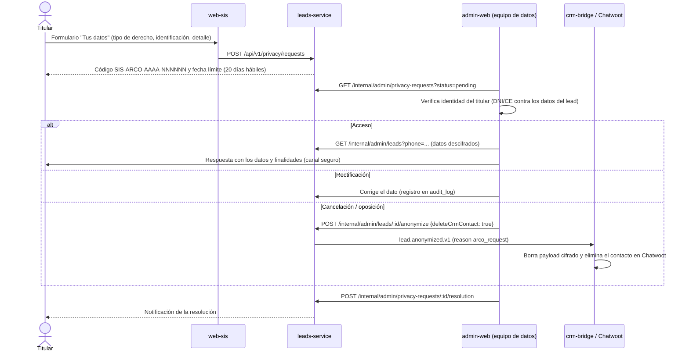

# Retención de datos y derechos ARCO (C9, C11)

Marco: Ley N.º 29733 de Protección de Datos Personales y su Reglamento (D.S. N.º 016-2024-JUS). Responsable del tratamiento: la sociedad del grupo titular de la marca SIS (completar razón social y RUC en la política de privacidad). El texto legal definitivo lo valida el área legal; este documento describe cómo lo implementa la plataforma.

## Qué datos se guardan y dónde

| Dato                                                  | Dónde                                          | Protección                                                                                     |
| ----------------------------------------------------- | ---------------------------------------------- | ---------------------------------------------------------------------------------------------- |
| Nombre, teléfono, correo                              | leads-service (`leads`)                        | Cifrado AES-256-GCM en reposo; hashes HMAC para duplicados (ADR 0009)                          |
| Consentimiento (versión de política, casillas, fecha) | `consent_records`                              | Append-only: trigger que rechaza DELETE y solo permite UPDATE que anule `ip_hash`/`user_agent` |
| IP                                                    | Solo como hash con pimienta (`IP_HASH_PEPPER`) | Nunca en claro                                                                                 |
| Atribución (UTM, referer)                             | leads-service                                  | Se borra al anonimizar                                                                         |
| Payload de sincronización                             | crm-bridge (`sync_jobs`)                       | Cifrado; se borra al anonimizar                                                                |
| Contacto y conversación                               | Chatwoot (sistema externo)                     | Se elimina si la solicitud lo pide (`deleteCrmContact`)                                        |
| Reclamaciones                                         | leads-service (`complaints`)                   | Plazo legal propio (abajo)                                                                     |
| Copias de seguridad                                   | Volumen `backups` + copia externa              | Cifradas con `age`; caducan a los 14 días                                                      |

## Plazos de conservación

| Dato                                       | Plazo                                                            | Mecanismo                                                                                       |
| ------------------------------------------ | ---------------------------------------------------------------- | ----------------------------------------------------------------------------------------------- |
| Leads sin relación contractual             | **730 días** desde el registro (`LEAD_RETENTION_DAYS`)           | Job diario de anonimización en leads-service; publica `lead.anonymized.v1` (reason `retention`) |
| Hash de IP y user agent del consentimiento | Mismo plazo que el lead                                          | UPDATE permitido por el trigger (pone `NULL`)                                                   |
| Registro de consentimiento (sin IP/UA)     | Mientras dure el tratamiento + 5 años (prueba de consentimiento) | Append-only                                                                                     |
| Libro de reclamaciones                     | **2 años** desde la respuesta (normativa de INDECOPI)            | Depuración manual anual desde el panel (pendiente de automatizar)                               |
| Solicitudes ARCO y su respuesta            | 2 años                                                           | Igual que reclamaciones                                                                         |
| Logs de aplicación                         | 30 días (sin datos personales: redacción en nest-kit)            | Rotación de logs del host / plataforma                                                          |
| Eventos en Sentry                          | 30 días (plan)                                                   | `beforeSend` elimina PII                                                                        |
| Copias de seguridad                        | 14 días                                                          | Retención del servicio `pg-backup`                                                              |

Anonimizar = nombre `[anonimizado]`, teléfono y correo cifrados vacíos, hashes `NULL`, atribución borrada, `anonymized_at` con la fecha. El lead se conserva como registro estadístico (promoción, campaña, fecha) sin datos identificables.

## Flujo ARCO (acceso, rectificación, cancelación, oposición)

Reglas operativas:

- **Plazos:** el sistema calcula `responseDueBy` en días hábiles (lunes a viernes, excluyendo `PERU_HOLIDAYS`). Acceso: 20 días hábiles; rectificación, cancelación y oposición: 10 días hábiles según el Reglamento (el panel muestra la fecha de 20 días como máximo; el equipo debe priorizar las de 10).
- **Verificación de identidad** antes de entregar o modificar datos; nunca responder a un correo distinto del registrado sin verificación adicional.
- **Registro:** cada acción del panel deja `caller=admin-web`, `actor=<correo>` y la acción en `audit_log`.
- **Denegación** fundada (p. ej. identidad no verificada) también se registra con su motivo.
- **Terceros:** si el lead se envió a Meta (solo con consentimiento de marketing), indicar al titular cómo ejercer sus derechos ante Meta; la plataforma no reenvía eventos tras la anonimización.

## Consentimiento

- La versión de la política aceptada se valida contra una lista permitida; la casilla de marketing es opcional y separada (Meta CAPI y seguimiento por WhatsApp solo con ella).
- `consent_records` es append-only: un cambio de consentimiento crea un registro nuevo; nunca se edita el anterior.
- Revocar el consentimiento de marketing = registro nuevo con `marketingAccepted=false`; los consumidores lo respetan desde ese momento.

## Responsabilidades

| Rol                                              | Responsable                                                 |
| ------------------------------------------------ | ----------------------------------------------------------- |
| Atención de solicitudes ARCO                     | Equipo de protección de datos (designar persona y suplente) |
| Ejecución técnica (anonimización, exportaciones) | Coordinación de sistemas con acceso `admin` en el panel     |
| Revisión anual de plazos y de la política        | Legal + protección de datos                                 |
